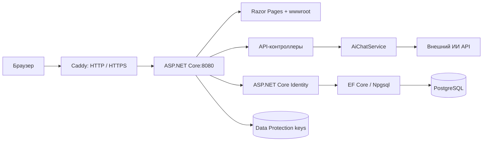

# Архитектура

[← README](../README.md) · [API](API.md) · [Настройки](CONFIGURATION.md)

## Общая схема

Это одно ASP.NET Core приложение: сервер формирует HTML через Razor Pages, отдаёт статические файлы и обслуживает JSON API. Отдельного SPA-сервера и frontend build pipeline нет.

При локальном запуске через базовый Compose браузер обращается к приложению напрямую на localhost:8080. На VPS входной трафик проходит через Caddy; приложение слушает 8080, БД — 5432 внутри сети Compose.

## Сервер и страницы

`Program.cs` регистрирует DbContext, Identity, Razor Pages, контроллеры и HttpClient. Затем настраивает forwarded headers, обработку ошибок/HSTS, HTTPS-редирект, статику, маршрутизацию, аутентификацию и авторизацию. При старте `MigrateAsync` применяет отсутствующие EF-миграции; без доступной PostgreSQL приложение не завершит запуск.

| Каталог / файл | Ответственность |
| --- | --- |
| `Pages/Index.cshtml` | Главная страница и клиентская логика чата |
| `Pages/Wifi.cshtml` | Карта Яндекса и демонстрационный список точек |
| `Pages/Diagnost.cshtml`, `Pages/Result.cshtml` | Диагностика и результаты измерений |
| `Pages/SpeedTest.cshtml` | Запросы к download/upload API и расчёт скорости |
| `Pages/Auth/` | Регистрация, вход и POST-выход |
| `Pages/Shared/_Layout.cshtml` | Общая оболочка, навигация, ресурсы |
| `wwwroot/js/main.js` | Тема, cookie-баннер, маска телефона, диагностическая модалка |
| `Controllers/` | Приём запросов чата и спидтеста |
| `Services/AiChatService.cs` | Внешний запрос к модели и извлечение ответа |

## Авторизация и данные

`DoomRuContext` наследуется от `IdentityDbContext<IdentityUser>`. EF Core создаёт стандартные таблицы `AspNetUsers`, `AspNetRoles`, `AspNetUserClaims`, `AspNetUserLogins`, `AspNetUserRoles`, `AspNetUserTokens` и `AspNetRoleClaims`. Номер телефона используется как `UserName`, пароль хранится в формате хеша Identity.

Регистрация создаёт пользователя и сразу выполняет вход. Телефон проверяется по формату `+7` + 10 цифр; SMS не отправляется, `PhoneNumberConfirmed` выставляется приложением. Вход выдаёт cookie, формы защищены antiforgery-токеном. JWT и отдельного REST API пользователей нет. Контроллеры API сейчас доступны анонимно.

`Models/User.cs` содержит вспомогательные модели `User` и `Ai`, но они не подключены через DbSet и не образуют действующую бизнес-схему. Данные согласий из этой модели в текущую БД приложением не записываются.

В V4.5 добавлена миграция `20261016135752_InitialCreate` и model snapshot. `MigrateAsync` применяет только отсутствующие миграции. Для старых БД, созданных через `EnsureCreatedAsync`, перед обновлением нужна проверка эквивалентности схемы и baseline; см. [database/README.md](../database/README.md). Изменение модели без новой миграции не обновит БД.

## Что хранится в браузере

| Место | Данные |
| --- | --- |
| `localStorage` | `dr_theme`, `dr_cookie_accepted` |
| `sessionStorage` | Ответы диагностической формы под ключом `answers` |
| Память страницы | История ИИ-чата; после обновления страницы теряется |
| Cookie | Сессия Identity и antiforgery |

История чата и ответы диагностики не сохраняются в PostgreSQL. Измерение скорости отражает путь браузер → сервер приложения и зависит от загрузки/географии сервера. Карта и шрифты требуют доступа браузера к внешним ресурсам.

## Контейнеры и хранение

Dockerfile выполняет restore и Release publish в SDK-образе. В финальном ASP.NET runtime-образе приложение работает от пользователя `app`; curl используется для healthcheck.

| Том | Содержимое |
| --- | --- |
| `postgres-data` | Данные PostgreSQL |
| `app-keys` | Data Protection keys для чтения ранее выданных cookie |
| `caddy-data`, `caddy-config` | Сертификаты и состояние Caddy в HTTPS-варианте |

Сохранение БД без `app-keys` не гарантирует сохранность действующих сессий. `down` сохраняет тома, `down -v` их удаляет. Data Protection keys дополнительно не зашифрованы; доступ к серверу и резервным копиям тома нужно ограничивать.

В HTTPS-варианте доверяется адрес прокси `172.30.77.10`: forwarded scheme позволяет приложению видеть HTTPS за Caddy. При изменении сети нужно синхронно изменить адрес прокси и `ReverseProxy__KnownProxy`.
