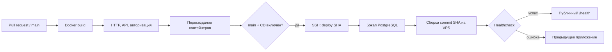

# CI/CD: GitHub Actions → VPS

[← README](../README.md) · [Сервер и обслуживание](../deploy/README.md)

Workflow: [`.github/workflows/ci-cd.yml`](../.github/workflows/ci-cd.yml). Проверки выполняются для pull request, push в `main` и ручного запуска через Actions → **CI and deploy → Run workflow**.



## Что проверяет CI

1. Bash-синтаксис и ShellCheck deploy-скриптов, конфигурации HTTP/HTTPS Compose.
2. Реальную многоэтапную сборку Dockerfile, запуск приложения, PostgreSQL и Caddy.
3. `/health`, основные страницы, CSS/изображения, download/upload, валидацию пустого и слишком длинного сообщения ИИ без вызова платной модели.
4. Создание пользователя и вход через формы с cookie/antiforgery.
5. `compose down` / `up` без удаления томов, сохранение аккаунта и ранее выданной сессии.

CI использует отдельный Compose project `doomru-ci`, случайный пароль БД и пустой AI-ключ. Тестовые тома удаляются в `always()`; к данным VPS CI не подключается. При ошибке выводятся логи контейнеров. Авторизация ИИ-провайдера и реальная отправка SMS в CI не проверяются.

## Как устроен CD

Только успешный job `test` для `main` может запустить `deploy`. Pull request, включая fork, не получают deploy-секреты. `DEPLOY_ENABLED=true` включает CD; при другом значении deploy-job пропускается.

GitHub-hosted runner подключается по отдельному SSH-ключу и отправляет `deploy <github.sha>`. Ключ на сервере ограничен forced command; интерактивная оболочка и forwarding для него запрещены. Host key проверяется по сохранённому `known_hosts`, без `StrictHostKeyChecking=no`.

На VPS `deploy.sh`:

1. Берёт `flock`, отказывается затирать локальные изменения checkout.
2. Загружает `origin/main`, проверяет полный SHA и принадлежность commit истории main.
3. Сохраняет прежний image и делает `pg_dump -Fc` в `/var/backups/doomru`.
4. Переключает checkout в detached HEAD на проверенный SHA и собирает image `doomru-web:<sha>`.
5. Выполняет `compose up --no-build --wait`, проверяет `/health` приложения.
6. При ошибке возвращает прежний checkout/image и пытается запустить предыдущую конфигурацию. Job остаётся неуспешным.

После успешного SSH-шагa runner отдельно проверяет публичный `/health`. Эта внешняя проверка не запускает автоматический rollback: сбой может находиться в сети между runner и VPS.

CI-образ не публикуется в GHCR: на VPS повторно собирается тот же commit. Это сохраняет простой deploy без registry credentials, но image не является побайтово тем же артефактом CI. Старые образы и бэкапы сохраняются для восстановления; их нужно периодически архивировать/удалять вручную.

## Настройка GitHub

В **Settings → Secrets and variables → Actions** задайте Repository secrets:

| Secret | Содержимое |
| --- | --- |
| `DEPLOY_SSH_KEY` | Отдельный приватный Ed25519-ключ CI, целиком с BEGIN/END |
| `DEPLOY_KNOWN_HOSTS` | Проверенная строка host key сервера; для нестандартного порта — `[host]:port` |
| `DEPLOY_HOST` | IP/домен SSH-сервера |
| `DEPLOY_USER` | Пользователь с правами deploy; на текущем VPS используется root |
| `DEPLOY_PORT` | SSH-порт, например 22 |

Repository variables:

| Variable | Значение |
| --- | --- |
| `DEPLOY_ENABLED` | `true`, чтобы включить CD; `false` — временно выключить |
| `DEPLOY_URL` | Публичный origin без `/health`, например `https://example.org` |

Job использует environment `production`. При желании ограничьте его веткой main и включите required reviewers в Settings → Environments. Личный SSH-ключ разработчика для CI не нужен. Пароль БД и ключ ИИ остаются только в `.env` VPS, а не в workflow.

## Первичная установка SSH-доступа CI

Выполняется администратором после установки Docker и checkout проекта в `/opt/unauth-dom-ru`:

```bash
install -m 755 /opt/unauth-dom-ru/deploy/ssh-entrypoint.sh /usr/local/sbin/doomru-ci-entrypoint
printf 'http\n' > /etc/doomru-deploy-mode
chmod 600 /etc/doomru-deploy-mode
```

Создайте отдельный ключ `ssh-keygen -t ed25519 -f doomru-ci -C doomru-github-actions` без passphrase для job. Его публичную часть добавьте **отдельной строкой** в `/root/.ssh/authorized_keys`:

```text
restrict,command="/usr/local/sbin/doomru-ci-entrypoint" ssh-ed25519 PUBLIC_KEY_HERE doomru-github-actions
```

Приватную часть внесите только в `DEPLOY_SSH_KEY`. Сверьте fingerprint host key через доверенную консоль сервера, затем сохраните его строку в `DEPLOY_KNOWN_HOSTS`. Пример команды CI: `ssh -i doomru-ci root@SERVER 'deploy FULL_COMMIT_SHA'`.

`ssh-entrypoint.sh` устанавливается вне checkout и не обновляется автоматически при deploy. При изменении его правил администратор повторно устанавливает файл после ревью. Сам deploy-скрипт исполняет код из доверенной ветки main с правами deploy-пользователя: доступ на запись в main и к workflow должен быть только у доверенных участников.

## Ограничения и восстановление

Workflow и серверный lock сериализуют deploy; запущенный deploy не отменяется новым push. Во время пересоздания приложения возможна короткая пауза — это не blue-green развёртывание. Если старый commit уже удалён из main, CD его не примет.

Rollback возвращает **приложение**, но не восстанавливает БД автоматически. Изменения схемы должны быть обратно совместимыми; автоматическое восстановление дампа могло бы уничтожить новые пользовательские данные. Процедура ручного rollback и восстановления описана в [deploy/README.md](../deploy/README.md).

Для остановки автодеплоя установите `DEPLOY_ENABLED=false`: сайт продолжит работать. Для отзыва доступа удалите только CI-строку из `authorized_keys` и соответствующий GitHub secret.

Официальные справочники: [GitHub environments](https://docs.github.com/en/actions/concepts/workflows-and-actions/deployment-environments), [Docker Compose](https://docs.docker.com/compose/how-tos/startup-order/).
