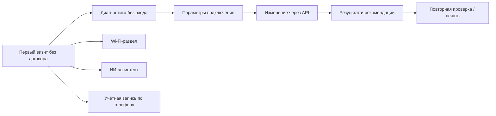

# Продукт: ценность до договора и реализованный MVP

[← README](../README.md) · [План развития](ROADMAP.md) · [Архитектура](ARCHITECTURE.md)

## Задача кейса

Кейс ЭР-Телеком «Как спроектировать неавторизованную зону приложения» ставит задачу дать пользователю самостоятельную ценность до договора. Полезные сценарии должны помогать знакомиться с сервисами оператора и переходить к подключению, сохраняя авторизованную зону для обслуживания действующих клиентов.

В постановке выделены понятность первого визита, короткий путь к следующему шагу, баланс пользы и конверсии, внедрение без полной переработки приложения. Горизонт 3–6 месяцев указан в кейсе как рамка внедрения; это не подтверждённая длительность интеграции нашего прототипа.

## Подход Solid Eagle

В презентации команды проблема описана как отсутствие самостоятельной ценности для человека без договора, разрыв между доступными функциями и мотивацией пользователя, сложность знакомства с Movix и Умным домом. Решение строится вокруг полезного действия при первом посещении: проверить своё подключение и получить понятный результат.

Текущий MVP — отдельное веб-приложение, демонстрирующее этот сценарий. Интеграция в мобильное приложение «Мой Дом.ру» пока не выполнена.

## Что подтверждено реализацией

| Часть решения | Реализация в репозитории |
| --- | --- |
| Гостевой доступ | Страницы диагностики и API доступны без договора и входа; создание аккаунта не требуется для измерения |
| Контекст проверки | В `Pages/Diagnost.cshtml` можно выбрать провайдера, скорость 50/100/300 Мбит/с либо «Не знаю», модель роутера и кабель/Wi-Fi |
| Переход к результату | `wwwroot/js/main.js` сохраняет ответы в `sessionStorage` и открывает `/Result` |
| Передача тестовых данных | `SpeedTestController` генерирует download-данные и считает принятые upload-байты |
| Сравнение с тарифом | `Pages/Result.cshtml` использует выбранную download-скорость для сравнения с замером |
| Визуальная интерпретация | Страница результата показывает метрики и эвристическую оценку; доступны общие советы и повторная проверка |
| Сохранение результата | Кнопка вызывает `window.print()`; сохранение в PDF возможно средствами браузера |
| Учётная запись | Identity хранит пользователя в PostgreSQL и выдаёт cookie; договор оператора не запрашивается |
| Интерфейс | Общий layout и переключение темы с `localStorage`; карта Яндекса встроена в Wi-Fi-раздел |
| Воспроизводимость | Docker/Compose, deploy-скрипт, smoke-тесты, CI/CD, постоянные тома БД и ключей сессий |

Внешний ИИ API подключён через `AiChatService`, но доступность ответов зависит от ключа и квоты. При проверке размещённого приложения провайдер возвращал `402 PaymentRequired`; это ограничение указано в [API](API.md) и [результатах проверки](../deploy/VALIDATION.md).

## Статус идей из презентации

Презентация показывает продуктовую концепцию шире текущей реализации. Ниже указано, какие части требуют дальнейшей разработки.

| Идея презентации | Текущее состояние |
| --- | --- |
| Диагностика с учётом тарифа и оборудования | Download сравнивается с выбранной скоростью. Модель роутера и тип подключения собираются формой, но пока не влияют на расчёт оценки |
| Пинг и стабильность сети | Есть оценка времени HTTP-запросов. Это не ICMP ping; отдельная проверка packet loss/jitter и стабильности канала не реализована |
| Персональные рекомендации | На странице результата есть общие советы. Подбор по модели роутера и подтверждённой причине проблемы ещё не реализован |
| Wi-Fi-квест «5 точек → промокод» | Есть интерфейс и фиксированный прогресс «2 из 5». Проверка посещения/подключения, серверный прогресс и выдача реального промокода отсутствуют |
| Карта точек и фильтры | Встроена карта Яндекса, отображаются демонстрационные карточки и кнопки фильтров. Живой каталог хот-спотов, геопоиск и фильтрация данных не подключены |
| Путь к продаже | В интерфейсе есть предложение выбрать тариф. Оформление заявки, проверка адреса подключения и CRM-интеграция пока отсутствуют |
| Раздельные согласия и хранение данных | Есть cookie-баннер и вспомогательная модель согласий, не подключённая к DbContext. Версионируемый реестр согласий и полный процесс работы с ними не реализованы; соответствие требованиям не подтверждалось |
| Внедрение в действующее приложение | Предложено в концепции; сейчас развёрнут отдельный веб-прототип |

Эффект на конверсию, удержание и продажи пока не измерялся. Работающее демо подтверждает техническую осуществимость основного сценария, а продуктовые гипотезы требуют проверки на пользователях.

## Источники

- Презентация кейса «Кейс_ЭРТХ_Мой Дом.ру»: слайды 4–8 — проблема и ценность до договора, 9–11 — задачи и рамки внедрения.
- Презентация команды «Solid_Eagle»: слайды 2 и 4–9 — проблема, преимущества и пользовательские сценарии; слайд 10 — предложения по развитию.
- Код приложения и результаты запуска из `deploy/VALIDATION.md`. При расхождении формулировок презентации и текущего кода статус реализации определяется кодом.
